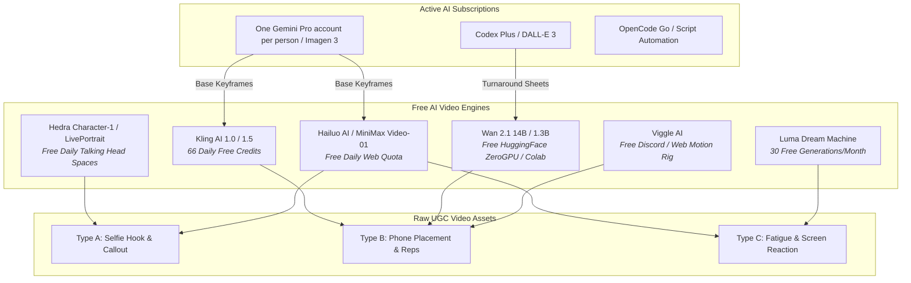

# Strategic Plan: AI UGC Video Generation for Training Arena

**Historical strategy, not the accepted production workflow.** The current
continuous 60-second actor-only brief, budget/realism gates and corrections are
in [21 October launch review](../audit/LAUNCH_REVIEW_2026-10-21.md#acquisition-and-the-exact-video-brief).
Short prompt-matrix outputs and still-image preview videos do not satisfy that
brief. Provider/quota/model claims below are historical and require fresh
verification before use. No repeatable zero-cost solution meeting the exact
brief has been demonstrated; the owner cannot film/post themselves.

Prepared: 2026-09-26 · Companion: `docs/social/CONTENT_EXPERIMENT.md`, `docs/social/briefs/BRIEF-03-ai-dramatization.md`

## Hard gates

- No video may show a phone counting reps or any counter UI until `qa/camera/beta_device_results.json` holds real devices with status `passed`.
- One account per person per provider. Multiplying free quotas with multiple accounts is not permitted.
- Before using an AI video tool commercially, record its commercial-use terms URL and the date checked. Without that record the tool is not allowed.

## 1. Executive Summary & Objective

This document formalizes the production strategy for generating **photorealistic, high-converting User-Generated Content (UGC) video clips** for Training Arena.

### Strict Scope Boundary
- **Generation Only**: Focused purely on raw UGC video asset synthesis (hook shots, phone placement, workout execution, and reactions). Editing, timeline sequencing, and copywriting/scripting are excluded.
- **$0 Model Cost**: Operates entirely within free daily allowances of state-of-the-art video platforms and open-source models on free cloud compute.
- **Subscription Leverage**: Utilizes **Codex Plus**, **OpenCode Go**, and **one Gemini Pro account per person** for multi-modal prompt synthesis, image anchors, and visual quality assurance.
- **Truth Rules & Compliance**: Follows `docs/social/CONTENT_EXPERIMENT.md` §2 and `docs/social/briefs/BRIEF-03-ai-dramatization.md` §1 (synthetic individuals are framed as dramatization actors, labeled per platform AI disclosures, and never fabricated as genuine customers).

---

## 2. Resource Allocation Matrix

| Subscription / Engine | Capabilities & Quotas | Designated Role |
| :--- | :--- | :--- |
| **One Gemini Pro account per person** (Google AI Studio) | • one provider allowance per person • High RPM / RPD free tier • Imagen 3 photo generation • Gemini 2.0 Flash / 1.5 Pro multi-modal vision | **1. Master UGC Prompt Engineering** (converts simple briefs into smartphone optics and physics prompts). **2. Anchor Image Synthesis** (creates raw, unfiltered 9:16 portrait stills). **3. Frame Inspection** (scans generated video frames for anatomical defects or warping). |
| **Codex Plus** (ChatGPT Plus / GPT-4o) | • Advanced reasoning • DALL-E 3 image generation • GPT-4o vision critique | **1. Secondary Character Anchor Sheets** (turnaround poses). **2. Automation Scripting** (Python orchestration scripts). |
| **OpenCode Go** | • High-speed code / API execution | **1. API Bridges & Free Endpoint Triggers** (interfacing with Hugging Face ZeroGPU spaces or Colab notebooks). **2. Generation Cataloging** (logging seeds, prompts, and approved asset hashes). |

---

## 3. Free Video Generation Model Matrix

### Engine Selection Guide

1. **Kling AI (1.0 / 1.5)** — *66 Free Daily Credits*
   - Best for **complex physical movements**: pushing up from floor, lowering body weight, stepping into frame.
   - Preserves limb structure when using Image-to-Video (I2V) with low-to-medium motion (strength 3–5).
2. **Hailuo AI / MiniMax Video-01** — *Free Web Tier*
   - Best for **micro-facial expressions and human skin realism**. Does not output plastic "AI sheen".
   - Ideal for reaction shots, heavy breathing, smiling, and talking.
3. **Wan 2.1 (Alibaba Open Weights 14B & 1.3B)** — *Free ZeroGPU on Hugging Face / Colab*
   - SOTA open video model with exceptional temporal stability.
   - Ideal for high-repetition workout cycles without temporal flickering.
4. **Hedra (Character-1) & LivePortrait** — *Free Web Tier & Free HF Spaces*
   - Produces natural talking heads with synchronous lip movements and realistic eye blinks from a single portrait image.
5. **Luma Dream Machine (Ray-1 / Ray-2)** — *30 Free Monthly Generations*
   - Excellent for dynamic camera panning (e.g., ground-level view panning to phone on floor).
6. **Viggle AI** — *Free Discord / Web Tier*
   - Motion transfer: maps a synthetic UGC character onto a real video of an athlete doing pushups or squats, guaranteeing 100% correct biomechanics.

---

## 4. The 3 Core UGC Asset Types

To fulfill Training Arena promotional requirements, production generates three distinct footage components:

| Asset Type | Framing & Camera | Action & Content | Recommended Engine |
| :--- | :--- | :--- | :--- |
| **Type A: Hook / Callout** | Vertical 9:16, handheld selfie angle at arm's length. | Creator looks into camera, smirks/speaks, challenges viewer to a 60-second battle. | Hedra / LivePortrait / Hailuo AI |
| **Type B: Phone Setup & Reps** | Vertical 9:16, low-angle floor view. Phone propped against shoe/bottle in foreground. | Creator steps back, drops into plank/squat stance, executes smooth, controlled repetitions. | Kling AI 1.5 / Wan 2.1 / Viggle AI |
| **Type C: Fatigue & Reaction** | Vertical 9:16, medium close-up on floor. | Creator drops to knees exhausted, breathes heavily, picks up phone, reacts with excitement/disbelief. | Hailuo AI / Kling AI 1.5 |

---

## 5. The Image-to-Video (I2V) Pipeline

> [!IMPORTANT]
> **Why Direct Text-to-Video (T2V) Fails for UGC:**  
> Prompting video models directly with text produces glossy cinematic lighting, distorted fingers, drifting faces, and plastic skin.  
> **The Rule of AI UGC:** Always use **Image-to-Video (I2V)**. Generate a gritty, authentic smartphone-style photograph first, then animate it.

### Step 1: Base Anchor Synthesis (Gemini Pro / Imagen 3)
Generate a base photograph with authentic UGC camera characteristics.

**Prompt Anti-Patterns (Never Use):**
`cinematic, masterpiece, 8k, unreal engine, photorealistic, studio lighting, glamour shot, fashion model`

**Prompt Pro-Patterns (Always Use):**
`Shot on iPhone 12 front camera, vertical 9:16, amateur video still, natural room lighting, slightly messy living room, wooden floor, casual workout clothes, authentic skin texture, slight grain, natural posture`

### Step 2: Animating the Frame
Feed the approved still image into Kling AI or Hailuo AI:
- Set **Motion Strength** to 3–4 (prevents anatomical tearing).
- Keep text prompt focused on camera shake and body movement (e.g., *"handheld phone shake, person blinks and speaks naturally"*).

---

## 6. Daily Production Routine (100% Free)

1. **Morning (Anchor Stills)**:
   - Use one Gemini Pro account per person to generate 15 base keyframes in Google AI Studio.
   - Use Codex Plus (GPT-4o vision) to audit anatomy (finger count, joint angles).
2. **Midday (Motion Generation)**:
   - Run 3–4 action clips on Kling AI (using 30–40 daily free credits).
   - Run talking-head hooks on Hailuo AI / Hedra.
3. **Afternoon (Review & Archive)**:
   - Verify movement against the red lines checklist below.
   - Archive valid clips into project media storage.

---

## 7. Quality Assurance Red Lines

- **Anatomical Integrity**: Immediate discard if hands morph, additional limbs appear, or knees bend backwards.
- **UGC Look & Feel**: Reject any clip with glossy high-fashion lighting or uncanny plastic skin.
- **Physical Plausibility**: Pushup torso must remain rigid; no floating bodies or rubbery spines.
- **Platform AI Labeling**: All generated clips must be marked for platform disclosure (`AI-generated dramatization`) as required by Meta and TikTok.
